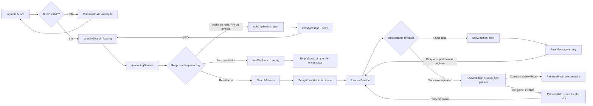

# Weather App — Technical Plan

> **Fonte:** `specs/weather-app-spec.md` (fonte única da verdade — 27 ACs, 16 ECs, matrizes de rastreabilidade).
> **Fase SDD:** Plan — decisões técnicas e contratos; sem código final de implementação.
> **Idioma:** narrativa em pt-BR; identificadores e termos técnicos em en-US.

---

## 1. Architecture

SPA client-side (A-01, D4/NFR-07: sem backend, sem autenticação, sem API key), organizada em **quatro camadas** com dependências unidirecionais:

```
┌─────────────────────────────────────────────────────────────┐
│ UI Layer — src/components/                                  │
│ App compõe hooks e componentes; componentes React            │
│ apresentacionais (um por arquivo):                          │
│ SearchBar · SearchResults · CurrentWeatherPanel ·           │
│ ForecastPanel · UnitToggle · LoadingIndicator ·             │
│ ErrorMessage · EmptyState                                   │
└──────────────────────────┬──────────────────────────────────┘
                           │ estado e callbacks via props
┌──────────────────────────▼──────────────────────────────────┐
│ State Layer — src/hooks/                                    │
│ useCitySearch · useWeather · useTemperatureUnit             │
│ Orquestram async state, cancelamento (EC-08) e retry        │
│ (AC-07.2); único lugar com efeitos colaterais de dados.     │
└──────────────────────────┬──────────────────────────────────┘
                           │ chamadas de função
┌──────────────────────────▼──────────────────────────────────┐
│ Service Layer — src/services/                               │
│ geocodingService · forecastService · httpClient             │
│ fetch + timeout 10 s (NFR-04), validação do contrato        │
│ mínimo (seção 2.1 da spec), classificação de erros          │
│ (EC-04/05/06/07), detecção de resposta parcial (EC-13/14).  │
└──────────────────────────┬──────────────────────────────────┘
                           │ dados tipados
┌──────────────────────────▼──────────────────────────────────┐
│ Domain Layer — src/lib/ + src/types/                        │
│ Funções puras: temperature (conversão/arredondamento,       │
│ AC-05.2/05.3) · wmoCodes (WMO → pt-BR, RF-03) ·             │
│ dateFormat (pt-BR, AC-04.2/AC-09.1) ·                       │
│ searchTerm (validação, AC-01.2) · tipos/contratos.          │
└─────────────────────────────────────────────────────────────┘
```

Decisões estruturais:

- **Clima atual e previsão diária são tratados como blocos independentes** dentro da mesma resposta da Forecast API: a validação, o estado e a renderização de cada painel são isolados, permitindo falha isolada por painel com retry próprio (AC-07.3, EC-14) sem derrubar o restante da tela.
- **Lógica de domínio 100% pura** (sem React, sem fetch), maximizando testabilidade unitária conforme a matriz "nível de teste" da spec.
- **Sem roteamento**: tela única, sem estado em URL (deep-linking está em Out of Scope, seção 9 da spec).

Fronteiras e dependências:

- `App.tsx` é o composition root: chama hooks e passa estado/callbacks aos componentes. Componentes em `components/` cuidam apenas de apresentação e interação acessível; não chamam hooks de dados, APIs nem implementam regras de domínio.
- `hooks/` compõe estado React e orquestra chamadas a `services/`; é a fronteira entre UI e efeitos assíncronos.
- `services/` encapsula HTTP, parâmetros dos endpoints e validação/normalização de payloads externos para tipos de domínio. Não depende de componentes.
- `lib/` contém funções puras e determinísticas (validação do termo, conversão de temperatura, mapeamento WMO e formatação); não importa React nem realiza I/O.
- `types/` declara contratos compartilhados; não contém lógica executável.
- Dependências seguem `App → hooks → services → lib/types`; `App → components`; `components → types`; `hooks → services/types`; `services → lib/types`. `lib` e `types` não importam camadas superiores.

Essa separação permite testar `lib/` com unit tests sem DOM ou mocks; `services/` com respostas HTTP simuladas; hooks com `renderHook` e serviços mockados; componentes com Testing Library usando props; e fluxos integrados com Playwright interceptando a Open-Meteo. Assim, a maioria dos casos não depende de rede real, e falhas ficam localizadas na camada responsável.

## 2. Tech Stack

Stack fixa herdada do discovery (seção 1.3 da spec) — nenhuma dependência nova é introduzida:

| Tecnologia | Papel | Justificativa |
| --- | --- | --- |
| TypeScript (strict) | Linguagem | Contratos tipados do payload Open-Meteo (seção 2.1) detectam quebras de contrato em compile time; `strict` força tratamento de campos opcionais como `admin1` (EC-15). |
| React 19 + Vite | UI + build | D1/A-01: SPA client-side; hooks nativos cobrem todo o estado necessário (ver seção 7). |
| Tailwind CSS | Estilos | Tema dark glassmorphism (NFR-06) via tokens utilitários; facilita validar contraste 4.5:1 (AC-NFR-03c) com paleta centralizada em `tailwind.config.js`. |
| Vitest + Testing Library | Unit tests | Matriz da spec exige unit para lógica pura e componentes isolados; jsdom + user-event já instalados. |
| Playwright | E2E | Fluxos completos com API mockada via `page.route()` — permite simular latência (AC-06), falhas (AC-07) e respostas parciais (EC-13/14/15) deterministicamente. |
| Biome | Lint/format | Já configurado (`biome.json`); zero dependências adicionais. |
| pnpm | Package manager | Padrão do repositório (`packageManager` no `package.json`). |
| Open-Meteo | Dados | D1: Geocoding + Forecast sem API key (NFR-07: nenhum segredo no cliente). |

**Dependências explicitamente rejeitadas** (anti-over-engineering):

- **Redux/Zustand/Jotai:** o estado cabe em 3 hooks locais + 1 contexto trivial; uma store global adicionaria indireção sem benefício para uma tela única.
- **TanStack Query (react-query):** cache/refetch automático está fora de escopo (OQ-06; retry é sempre manual por RF-07); `fetch` + `AbortController` cobrem timeout (NFR-04) e cancelamento (EC-08).
- **axios:** `fetch` nativo é suficiente e suportado pelos browsers alvo (NFR-08).
- **date-fns/dayjs:** formatação limitada a dois padrões fixos (`dd/mm/aaaa hh:mm` — AC-09.1; `"qua, 29/10"` — AC-04.2), resolvível com `Intl.DateTimeFormat('pt-BR')` nativo.
- **zod/valibot:** o contrato mínimo tem ~10 campos; validação manual com type guards é mais simples e igualmente testável.

## 3. Project Structure

Segue as convenções do repositório (componentes um por arquivo; serviços, hooks e tipos em pastas dedicadas):

```
src/
├── main.tsx                      # bootstrap React
├── App.tsx                       # composição da tela única + wiring dos hooks
├── index.css                     # Tailwind layers + tokens do tema dark glassmorphism
├── components/                   # apresentacionais; recebem dados/callbacks via props
│   ├── SearchBar.tsx             # RF-01 — input + botão; submit por Enter/click (AC-01.1)
│   ├── SearchResults.tsx         # RF-02 — lista de desambiguação (AC-02.1/02.3)
│   ├── CurrentWeatherPanel.tsx   # RF-03 — temperatura, condição, cidade (AC-03.1/03.2)
│   ├── ForecastPanel.tsx         # RF-04 — 5 dias + aviso de previsão parcial (AC-04.3)
│   ├── ForecastDayCard.tsx       # RF-04 — item de dia (data, max/min, condição)
│   ├── UnitToggle.tsx            # RF-05 — alternância °C/°F (AC-05.x)
│   ├── FreshnessIndicator.tsx    # RF-09 — "atualizado em dd/mm/aaaa hh:mm" (AC-09.1)
│   ├── LoadingIndicator.tsx      # RF-06 — com aria-live (AC-NFR-03b)
│   ├── ErrorMessage.tsx          # RF-07 — mensagem pt-BR + botão retry (AC-07.1/07.2)
│   └── EmptyState.tsx            # RF-08 — inicial e "sem resultados" (AC-08.1/08.2)
├── hooks/
│   ├── useCitySearch.ts          # estado async da busca de cidades (RF-01/02/06/07/08)
│   ├── useWeather.ts             # estado async de clima/previsão por painel (RF-03/04/07/09, EC-08/14)
│   └── useTemperatureUnit.ts     # unidade ativa da sessão (RF-05, A-07)
├── services/
│   ├── httpClient.ts             # fetch + AbortController + timeout 10 s + classificação de erro
│   ├── geocodingService.ts       # Geocoding API: URL, parsing, validação do contrato
│   └── forecastService.ts        # Forecast API: parsing por bloco (current/daily), respostas parciais
├── lib/                          # funções puras; sem React, fetch ou outros efeitos colaterais
│   ├── temperature.ts            # celsiusToFahrenheit + arredondamento (AC-05.2/05.3)
│   ├── wmoCodes.ts               # mapa WMO code → descrição pt-BR + fallback (RF-03)
│   ├── dateFormat.ts             # formatDayLabel (AC-04.2) + formatTimestamp (AC-09.1)
│   └── searchTerm.ts             # normalização (trim) + validação mínimo 2 chars (AC-01.2)
└── types/
    ├── openMeteo.ts              # contratos brutos das APIs (seção 2.1 da spec)
    └── domain.ts                 # tipos de domínio da UI (City, CurrentWeather, AsyncState…)

tests/
├── unit/                         # Vitest — espelha src/ (utils, services, hooks, componentes)
│   └── fixtures/                 # payloads derivados do contrato 2.1 (nominal, parcial, inválido)
└── e2e/                          # Playwright
    ├── mocks/                    # fixtures + helpers de page.route()
    └── *.spec.ts                 # um spec por fluxo (ver seção 9)
```

## 4. Data Model

Derivado diretamente do **contrato mínimo de dados** (spec, seção 2.1). Campos fora do contrato são ignorados. Tipos abaixo são **especificação de contrato**, não implementação.

### 4.1 Contratos brutos da API (`src/types/openMeteo.ts`)

```ts
/** Resposta da Geocoding API (contrato mínimo — spec 2.1). */
interface GeocodingResponse {
  results?: GeocodingResult[]; // ausente/vazio ⇒ estado "sem resultados" (AC-08.2, EC-02)
}

interface GeocodingResult {
  name: string;       // obrigatório
  country: string;    // obrigatório
  latitude: number;   // obrigatório
  longitude: number;  // obrigatório
  admin1?: string;    // opcional — região/estado (EC-15, AC-02.3)
}

/** Resposta da Forecast API (contrato mínimo — spec 2.1). */
interface ForecastResponse {
  current?: {
    time: string;
    interval?: number;
    temperature_2m: number;  // sempre em °C (regra do contrato)
    weather_code: number;   // WMO code (RF-03)
  };
  daily?: {
    time: string[];                 // ISO date, fuso local da cidade (timezone=auto — EC-11)
    temperature_2m_max: number[];   // °C
    temperature_2m_min: number[];   // °C
    weather_code: number[];         // arrays alinhados; 5 posições no caso nominal
  };
}
```

> Ambos os blocos de `ForecastResponse` são opcionais no tipo porque a ausência de qualquer campo obrigatório **invalida apenas o bloco correspondente** (regra do contrato; EC-13/EC-14) — a validação por bloco acontece no `forecastService`.

### 4.2 Tipos de domínio da UI (`src/types/domain.ts`)

```ts
/** Cidade selecionável, normalizada a partir do geocoding (RF-02). */
interface City {
  name: string;
  country: string;
  region?: string;     // admin1; ausente ⇒ exibe "cidade, país" sem placeholder (AC-02.3)
  latitude: number;
  longitude: number;
}

/** Unidade de exibição; dados internos permanecem sempre em Celsius (regra 2.1). */
type Unit = 'celsius' | 'fahrenheit';

/** Clima atual validado (RF-03). Temperatura em °C — conversão só na apresentação. */
interface CurrentWeather {
  temperatureC: number;
  weatherCode: number;
  description: string;   // WMO → pt-BR; fallback "Condição desconhecida" (RF-03)
}

/** Dia da previsão validado (RF-04). */
interface ForecastDay {
  date: string;          // ISO, fuso local da cidade (EC-11)
  maxTemperatureC: number;
  minTemperatureC: number;
  weatherCode: number;
  description: string;
}

/** Previsão diária com sinalização de resposta parcial (AC-04.3, EC-13). */
interface DailyForecast {
  days: ForecastDay[];   // apenas dias válidos recebidos, ordem cronológica
  isPartial: boolean;    // true quando days.length < 5 ⇒ aviso de previsão incompleta
}

/** Estado de um painel após a resposta da consulta; permite falha isolada (EC-14). */
type PanelState<T> =
  | { status: 'success'; data: T }
  | { status: 'error'; error: AppError };

/** Resultado validado da consulta meteorológica — blocos independentes (EC-14). */
interface WeatherData {
  current: PanelState<CurrentWeather>;
  daily: PanelState<DailyForecast>;
  fetchedAt: Date;                  // horário local do dispositivo na recepção (RF-09)
}

/** Classificação de erro para mensagens pt-BR não técnicas (RF-07). */
type AppErrorKind =
  | 'network'          // falha de rede/offline (EC-04)
  | 'timeout'          // abortada após 10 s (EC-05, NFR-04)
  | 'service'          // HTTP 4xx/5xx, incl. rate limiting (EC-06, EC-07)
  | 'invalid-payload'; // estrutura fora do contrato 2.1 (EC-06)

interface AppError {
  kind: AppErrorKind;
  message: string;     // pt-BR, sem jargão técnico (AC-07.1)
}

/** Máquina de estados assíncronos — torna loading/erro/vazio impossíveis de ignorar. */
type AsyncState<T> =
  | { status: 'idle' }                       // estado inicial (AC-08.1)
  | { status: 'loading' }                    // RF-06
  | { status: 'success'; data: T }
  | { status: 'empty' }                      // busca concluída sem resultados (AC-08.2)
  | { status: 'error'; error: AppError };    // RF-07
```

## 5. Data Flow



Fluxo nominal (busca → service → estado → UI):

```
1. Usuário digita termo e aciona busca (Enter ou botão — RF-01)
   └─ searchTerm.validate(): trim + mínimo 2 chars
      ├─ inválido ⇒ orientação inline, NENHUMA requisição (AC-01.2, EC-01)
      └─ válido ⇒ useCitySearch → status 'loading' (feedback ≤ 100 ms — NFR-04)

2. useCitySearch → geocodingService.searchCities(term)
   └─ httpClient: GET geocoding-api…/v1/search?name={URL-encoded}&count=10&language=pt
      (EC-10: termo sempre URL-encoded, nunca interpretado como código)
   └─ parsing: filtra resultados que violam o contrato; normaliza para City[]
      ├─ lista vazia/ausente ⇒ 'empty' ⇒ EmptyState "sem resultados" (AC-08.2)
      ├─ erro ⇒ 'error' + AppError ⇒ ErrorMessage com retry (AC-07.1/07.2)
      └─ resultados ⇒ SearchResults exibe todos, na ordem da API (AC-01.1)

3. Usuário seleciona uma City (RF-02)
   └─ lista fecha; termo permanece no campo (RF-02)
   └─ useWeather.fetchWeather(city):
      · aborta requisição anterior em andamento via AbortController (EC-08)
      · status 'loading' — dados obsoletos nunca exibidos como novos (AC-06.2);
        dados da cidade anterior permanecem visíveis até a nova seleção (EC-16)

4. useWeather → forecastService.getWeather(lat, lon)
   └─ httpClient: GET api.open-meteo.com/v1/forecast?latitude=…&longitude=…
      &current=temperature_2m,weather_code
      &daily=temperature_2m_max,temperature_2m_min,weather_code
      &forecast_days=5&temperature_unit=celsius&timezone=auto
   └─ validação POR BLOCO:
      · current válido ⇒ PanelState success | inválido ⇒ PanelState error (EC-14)
      · daily: valida alinhamento dos arrays; monta ForecastDay[] só com
        posições válidas; isPartial = days.length < 5 (EC-13, AC-04.3)
      · um bloco inválido ⇒ erro apenas no painel correspondente (EC-14);
        ambos inválidos ⇒ erro global (EC-06)
   └─ sucesso ⇒ WeatherData { current, daily, fetchedAt: new Date() } (RF-09)

5. Render:
   · CurrentWeatherPanel: tempC → formatTemperature(unit) → "25 °C" / "77 °F";
     cidade + região + país (AC-03.1/03.2); wmoCodes → descrição pt-BR
   · ForecastPanel: dateFormat.formatDayLabel → "qua, 29/10" (AC-04.2);
     aviso quando isPartial (AC-04.3)
   · FreshnessIndicator: formatTimestamp(fetchedAt) → "dd/mm/aaaa hh:mm" (AC-09.1)
   · painel com status='error' ⇒ ErrorMessage local + retry (AC-07.3)

6. UnitToggle (RF-05): altera apenas Unit no contexto; re-render converte
   na apresentação a partir dos valores originais em °C — sem erro acumulado (AC-05.3);
   seguro em loading/erro/vazio pois não toca o estado de dados (AC-05.5, EC-09).
```

Retry (AC-07.2): cada hook retém os **parâmetros originais** da última requisição falha (termo de busca ou `City` selecionada) e os reexecuta sem exigir nova digitação/seleção. O retry de painel (EC-14) reexecuta a consulta de forecast e revalida ambos os blocos; `fetchedAt` é renovado (AC-09.2).

## 6. External APIs

Base: Open-Meteo, sem API key (D1, NFR-07). Temperaturas sempre solicitadas em Celsius (regra do contrato 2.1). Referências oficiais: [Geocoding API](https://open-meteo.com/en/docs/geocoding-api) e [Forecast API](https://open-meteo.com/en/docs).

### 6.1 Geocoding API (RF-01/RF-02)

```
GET https://geocoding-api.open-meteo.com/v1/search
    ?name={termo URL-encoded}        # trim aplicado antes; EC-10/EC-12
    &count=10                        # RF-01 (default da API, explícito)
    &language=pt                     # RF-01 (D5: interface pt-BR)
```

- Campos consumidos: `results[].name`, `country`, `latitude`, `longitude` (obrigatórios) e `admin1` (opcional — EC-15). Demais campos ignorados.
- `results` ausente ou vazio ⇒ estado vazio "nenhuma cidade encontrada" (AC-08.2) — **não é erro**.

Exemplo resumido de resposta (campos não consumidos omitidos):

```json
{
  "results": [
    {
      "name": "Salvador",
      "latitude": -12.9711,
      "longitude": -38.5108,
      "country": "Brasil",
      "admin1": "Bahia"
    }
  ]
}
```

Mapeamento: cada `results[]` válido vira `City` (`name`, `country`, `latitude`, `longitude`); `admin1` vira `region` quando presente. `results` ausente/vazio vira estado sem resultados, não `City`.

### 6.2 Forecast API (RF-03/RF-04)

```
GET https://api.open-meteo.com/v1/forecast
    ?latitude={lat}&longitude={lon}  # coordenadas exatas da City selecionada (AC-02.2)
    &current=temperature_2m,weather_code                         # RF-03
    &daily=temperature_2m_max,temperature_2m_min,weather_code    # RF-04
    &forecast_days=5                 # D2: hoje + 4 dias
    &timezone=auto                   # dias no fuso local da cidade (EC-11)
    &temperature_unit=celsius        # Celsius é a fonte única da verdade (RF-05)
```

Exemplo resumido de resposta (campos não consumidos omitidos):

```json
{
  "timezone": "America/Bahia",
  "current": {
    "time": "2026-10-29T14:00",
    "temperature_2m": 27.4,
    "weather_code": 2
  },
  "daily": {
    "time": ["2026-10-29", "2026-10-30"],
    "temperature_2m_max": [29.1, 28.5],
    "temperature_2m_min": [23.2, 22.8],
    "weather_code": [2, 3]
  }
}
```

Mapeamento para os tipos de domínio (temperaturas numéricas sempre em °C):

- `current.temperature_2m` → `CurrentWeather.temperatureC`; `current.weather_code` → `weatherCode`; o mesmo código alimenta `description` via mapa WMO → pt-BR, com fallback "Condição desconhecida".
- Para cada índice `i` de `daily.time`, os arrays alinhados `temperature_2m_max[i]`, `temperature_2m_min[i]` e `weather_code[i]` formam um `ForecastDay` (`date`, `maxTemperatureC`, `minTemperatureC`, `weatherCode`, `description`). Válidos seguem ordem cronológica; menos de cinco dias válidos define `DailyForecast.isPartial=true`.
- Os dois blocos são validados independentemente; bloco ausente/inválido mapeia para `PanelState` com `status: 'error'` em `WeatherData.current` ou `WeatherData.daily` (EC-14). `WeatherData.fetchedAt` é criado no cliente ao receber a resposta, não copiado de `current.time` (RF-09).
- Política comum às duas APIs (via `httpClient`):
  - **Timeout de 10 s** com `AbortController` ⇒ `AppError { kind: 'timeout' }` (EC-05, NFR-04);
  - HTTP não-2xx (incl. 429 de rate limiting) ⇒ `kind: 'service'` (EC-06, EC-07);
  - falha de fetch (offline/DNS) ⇒ `kind: 'network'` (EC-04);
  - JSON inválido ou contrato violado ⇒ `kind: 'invalid-payload'`; nenhum dado de resposta inválida é renderizado (EC-06).
- URLs base definidas como constantes substituíveis em teste (Playwright `page.route()` intercepta por padrão de URL).

## 7. State Management

**Decisão: hooks locais + 1 Context mínimo. Sem biblioteca de estado** (justificativa na seção 2).

| Estado | Onde vive | Conteúdo | Requisitos |
| --- | --- | --- | --- |
| Busca de cidades | `useCitySearch` (instanciado em `App`) | `AsyncState<City[]>`: `idle`, `loading`, `success` (resultados), `empty` (zero resultados) ou `error`; mantém o último termo válido para retry | RF-01/02/06/07/08, AC-07.2 |
| Dados meteorológicos | `useWeather` (instanciado em `App`) | `selectedCity` + `AsyncState<WeatherData>`: `idle`, `loading`, `success` ou `error`; em `success`, `current` e `daily` têm estados `success`/`error` independentes; mantém parâmetros do retry e ref do `AbortController` | RF-03/04/06/07/09, EC-08/13/14/16 |
| Unidade de temperatura | `useTemperatureUnit` + `UnitContext` | `Unit`, inicial `'celsius'` (D3, AC-05.1); sessão apenas, sem persistência (A-07/OQ-09) | RF-05, AC-05.x |
| Termo digitado | estado local do `SearchBar` | string crua do input (permanece após seleção — RF-02) | RF-01/02 |

Regras:

- **Estados explícitos:** busca começa em `idle`; submissão válida muda para `loading`; resposta não vazia vira `success`; resposta vazia vira `empty`; falha vira `error`. Em clima, a consulta começa em `loading`; falha de transporte/API vira `error`; sucesso da resposta vira `success` com cada painel em `success` ou `error`. `empty` é exclusivo da busca; previsão com 1–4 dias válidos é `success` com `isPartial=true` e aviso, enquanto zero dias válidos é erro daquele painel (EC-13/14).
- **Celsius como fonte única da verdade** no estado: serviços guardam temperaturas originais em °C. A renderização calcula °C (valor original) ou °F (`C × 9/5 + 32`) e arredonda o resultado para o inteiro mais próximo; a unidade é aplicada a todas as temperaturas e rótulos (RF-05, AC-05.2/05.3/05.4).
- **Sem novo request ao alternar unidade:** o toggle atualiza somente `UnitContext`; os valores apresentados são derivados novamente dos dados em °C já carregados. Assim, a alternância funciona durante loading/erro/vazio sem alterar parâmetros, refazer fetch ou acumular conversões (AC-05.5, EC-09).
- **Concorrência (EC-08):** `useWeather` aborta a requisição anterior ao iniciar uma nova; respostas de requisições abortadas são descartadas (verificação de `signal.aborted` / id de requisição). Só a seleção mais recente popula o estado (AC-06.2).
- **Context apenas para a unidade**, porque é o único estado lido por múltiplos componentes distantes (painel atual, previsão, toggle); busca e clima fluem por props a partir de `App` — prop drilling de 1 nível não justifica contexto.

## 8. Error Handling

Estratégia por classe de falha, com mensagens em pt-BR, feedback e recuperação rastreáveis à spec:

1. **Falha de rede/offline/DNS (EC-04):** classificar como `network`; mostrar mensagem pt-BR sem jargão e retry manual. Não tratar como busca vazia.
2. **Erro HTTP/API (EC-06/07):** respostas não-2xx (incluindo rate limit 429) viram `service`; payload JSON inválido ou estrutura fora do contrato vira `invalid-payload`. Mostrar mensagem de erro + retry, sem status code, stack trace ou dados inválidos (AC-07.1). A classificação ocorre no `httpClient`/services e é testável unitariamente.
3. **Timeout (NFR-04, EC-05):** `AbortController` + timer no `httpClient` aborta qualquer requisição sem resposta em 10 s e a converte em `timeout` recuperável com retry manual. Nenhuma requisição fica pendente indefinidamente (AC-NFR-05).
4. **Retry manual com parâmetros originais (RF-07, AC-07.2):** sem tentativas automáticas. Cada hook guarda os parâmetros da última requisição falha:
   - busca ⇒ reexecuta geocoding com o mesmo termo normalizado;
   - clima ⇒ reexecuta forecast com as mesmas coordenadas da `City`;
   - retry de painel (EC-14) ⇒ refaz a consulta de forecast; sucesso substitui o erro e renova `fetchedAt` (AC-09.2).
   Botão de retry com nome acessível e operável por teclado (AC-NFR-03a).

5. **Resposta parcial (EC-13/14/15, AC-04.3, AC-07.3):**
   - **EC-13** — `daily` com 1–4 dias válidos: `DailyForecast` é `success` com `isPartial=true`; exibir somente os dias recebidos e o aviso, sem inventar/duplicar dias. Sem dias válidos: erro local de previsão.
   - **EC-14** — um bloco válido e outro ausente/inválido: `WeatherData` fica `success`, com `PanelState` independente para `current` e `daily`; o painel válido renderiza normalmente e o inválido mostra `ErrorMessage` local com retry. Se ambos os blocos forem inválidos, tratar como `invalid-payload` global. A tela não cai inteira.
   - **EC-15** — `admin1` ausente no geocoding: dado válido; exibir cidade + país, sem placeholder quebrado (AC-02.3). Não aciona fluxo de erro.
   - Uma requisição abortada por ter sido substituída por outra (EC-08) é cancelamento esperado, não erro visível; apenas a seleção mais recente atualiza o estado.

`AsyncState` torna obrigatório tratar `idle`, `loading`, `success`, `empty` e `error`; `empty` representa apenas geocoding sem resultados (AC-08.2), enquanto `idle` representa a tela inicial (AC-08.1). Estados de loading/erro são anunciados conforme AC-NFR-03b. Erros de render inesperados são contidos por um error boundary simples no nível de `App` como última linha de defesa (NFR-05).

## 9. Testing Strategy

Segue a matriz **RF → AC → nível de teste** da spec. "Unit" = Vitest + Testing Library; "E2E" = Playwright com API mockada (`page.route()` — determinístico, sem dependência da Open-Meteo real).

### 9.1 Unit (Vitest + Testing Library)

Cobertura de lógica e limites de cada camada; serviços usam `fetch` mockado (`vi.stubGlobal`/`vi.fn`) e não acessam a rede real.

| Alvo | Casos principais | Rastreabilidade |
| --- | --- | --- |
| `lib/temperature.ts` | `25 °C → 77 °F`; `20.6 °C → 69 °F`; ida e volta sem erro acumulado; arredondamento ao inteiro mais próximo | RF-05, AC-05.2/05.3 |
| `lib/wmoCodes.ts` | códigos WMO conhecidos → descrição pt-BR; código desconhecido → "Condição desconhecida" | RF-03, AC-03.1 |
| `lib/searchTerm.ts` | vazio/só espaços/1 char após trim ⇒ inválido; "São Luís", "Val-d'Or", "123🌧", termo muito longo ⇒ válidos | RF-01, AC-01.2, EC-01/10/12 |
| `lib/dateFormat.ts` | `formatDayLabel` → "qua, 29/10"; `formatTimestamp` → `dd/mm/aaaa hh:mm`; datas no fuso da cidade | RF-04/09, AC-04.2/09.1, EC-11 |
| `services/geocodingService.ts` | `fetch` mockado; URL com encoding/count/language; parsing com/sem `admin1`; `results` ausente ⇒ resultado vazio; HTTP/payload inválido ⇒ erro classificado | RF-01/02, AC-01.1/01.3/02.3, EC-10/15 |
| `services/forecastService.ts` | `fetch` mockado; parsing nominal (5 dias); `daily` com 1–4 posições válidas ⇒ `isPartial`; bloco inválido ⇒ erro de painel; arrays desalinhados e payload inválido | RF-03/04, AC-04.3/07.3, EC-06/13/14 |
| `services/httpClient.ts` | `fetch` mockado; rede rejeitada, respostas 4xx/5xx/429, JSON inválido, timeout e cancelamento; verifica `AbortController` com fake timers | RF-07, AC-07.1, EC-04/05/06/07/08 |
| Hooks (`useCitySearch`, `useWeather`) | transições de estado, retry com parâmetros originais, cancelamento de requisição anterior, falha isolada de painel | AC-06.x/07.2/07.3, EC-08/14 |
| Componentes por props/estado | `LoadingIndicator` em loading; `ErrorMessage` em erro e callback de retry; `EmptyState` inicial e sem resultados; `SearchResults` com sucesso, cidade sem região; `CurrentWeatherPanel` sucesso/erro; `ForecastPanel` sucesso/parcial/erro; `UnitToggle` selecionado e acessível | AC-02.x/03.x/04.x/06.x/07.x/08.x, AC-NFR-03a/03b |

Fixtures em `tests/unit/fixtures/` derivadas do contrato 2.1: payload nominal, parcial (EC-13/14/15) e inválido (EC-06) — compartilhadas conceitualmente com os mocks E2E para manter uma única fonte de payloads.

### 9.2 E2E (Playwright, API mockada)

Interceptar todos os endpoints com `page.route()`; os E2E não dependem de disponibilidade externa. Executar os fluxos principais em desktop e um percurso completo em viewport mobile de **360 × 800 px**.

| Spec | Fluxo | Rastreabilidade |
| --- | --- | --- |
| `search-and-select.spec.ts` | estado inicial (AC-08.1) → busca → lista com região/país na ordem da API → seleção → painel com cidade correta; termo inválido não dispara request; termo com acentos | RF-01/02/08, AC-01.x/02.x/08.1 |
| `current-and-forecast.spec.ts` | clima atual (temperatura + condição pt-BR + cidade) e 5 dias em ordem cronológica com datas "qua, 29/10" | RF-03/04, AC-03.x/04.1/04.2 |
| `unit-toggle.spec.ts` | default °C (AC-05.1) → toggle ⇒ todas as temperaturas em °F convertidas → volta a °C sem desvio; unidade sempre rotulada; toggle durante loading/erro não quebra (EC-09); alternar unidade não dispara novo request de forecast | RF-05, AC-05.x |
| `loading-states.spec.ts` | respostas atrasadas mockadas ⇒ indicador na busca e no clima; remoção ao responder; seleção de nova cidade durante loading ⇒ resposta antiga descartada (EC-08); dados antigos visíveis até nova seleção (EC-16) | RF-06, AC-06.x |
| `error-retry.spec.ts` | falha de rede, timeout (>10 s) e 500 mockados ⇒ mensagem pt-BR + retry; retry reexecuta parâmetros originais e substitui o erro; freshness atualizado após retry (AC-09.2); nunca tela branca ou loading infinito (AC-NFR-05) | RF-07/09, AC-07.1/07.2/09.2 |
| `partial-responses.spec.ts` | 3 dias no `daily` ⇒ 3 cards + aviso (EC-13); `daily` ausente ⇒ painel atual OK + erro isolado com retry no painel de previsão, e vice-versa (EC-14); geocoding sem `admin1` ⇒ seleção funciona (EC-15) | AC-04.3/07.3, EC-13/14/15 |
| `empty-states.spec.ts` | estado inicial orientativo; busca com `results: []` ⇒ "nenhuma cidade encontrada" + sugestão de revisão | RF-08, AC-08.1/08.2 |
| `accessibility.spec.ts` | navegação completa por teclado com foco visível (AC-NFR-03a); nomes acessíveis e live regions para loading/erro (AC-NFR-03b); viewports 360/768/1280 px sem scroll horizontal (AC-NFR-01) | NFR-01/03 |
| `mobile-flow.spec.ts` | em 360 × 800 px, pesquisar, selecionar cidade, consultar clima/previsão e alternar unidade; confirmar controles visíveis/operáveis e ausência de scroll horizontal | RF-01/05, AC-01.x/03.x/04.x/05.x, AC-NFR-01 |

Verificações manuais/complementares (fora da automação mínima): contraste 4.5:1 do tema dark (AC-NFR-03c — auditoria com tooling de contraste) e compatibilidade de browsers (NFR-08 — projects do Playwright para Chromium/Firefox/WebKit cobrem o essencial).

## 10. Risks & Trade-offs

| # | Decisão | Trade-off / alternativa rejeitada | Mitigação / rastreio |
| --- | --- | --- | --- |
| 1 | `fetch` + `AbortController` em vez de axios/react-query | Sem cache, dedupe ou retry automático prontos — aceitável porque retry é manual por requisito (RF-07) e cache está fora de escopo (OQ-06); se cache local entrar (OQ-06), reavaliar TanStack Query. | R-02 coberto por timeout + retry + classificação de erro. |
| 2 | Hooks locais + Context mínimo, sem store global | Se o escopo crescer (favoritos, múltiplas cidades — hoje Out of Scope), o estado em `App` pode ficar denso; migração para Zustand seria localizada nos hooks. | Hooks encapsulam a API de estado ⇒ troca de implementação não afeta componentes. |
| 3 | Conversão °F somente na apresentação (estado sempre em °C) | Recalcula a cada render — custo desprezível para ~11 valores; elimina classe inteira de bugs de conversão (R-04) e erro acumulado (AC-05.3). | Testes unitários de `temperature.ts` + E2E do toggle. |
| 4 | Validação manual do payload (type guards) em vez de zod | Menos expressiva para contratos grandes; suficiente para ~10 campos do contrato 2.1 e sem dependência extra. | Fixtures inválidas/parciais nos testes de services (EC-06/13/14). |
| 5 | Mapa WMO → pt-BR mantido manualmente na aplicação | Tabela WMO é estável; códigos futuros não mapeados caem no fallback "Condição desconhecida" (RF-03) em vez de quebrar. | Teste unitário do fallback. |
| 6 | `Intl.DateTimeFormat` nativo em vez de date-fns | Formatos presos às convenções provisórias da spec ("qua, 29/10", `dd/mm/aaaa hh:mm`); mudanças via OQ-04 ficam isoladas em `dateFormat.ts`. | OQ-04 em aberto — único ponto de mudança. |
| 7 | Datas da previsão usadas como strings do fuso da cidade (`timezone=auto`), sem conversão para o fuso do usuário | Comportamento exigido por EC-11; cuidado necessário para não instanciar `Date` com timezone implícito do dispositivo ao formatar `daily.time[]`. | Teste unitário de `formatDayLabel` com fusos divergentes. |
| 8 | Sem persistência da unidade entre visitas | Preferência vale só para a sessão (A-07); se OQ-09 confirmar persistência, `useTemperatureUnit` ganha `localStorage` sem tocar nos componentes. | Mudança confinada a um hook. |
| 9 | Glassmorphism dark pode comprometer contraste (R-06) | Estética exigida (NFR-06) vs legibilidade (NFR-03); tokens de cor centralizados no Tailwind config permitem ajustar sem varrer componentes. | AC-NFR-03c como gate: ajustar estilo antes de flexibilizar acessibilidade. |
| 10 | Dependência de API pública sem SLA (R-02, OQ-05) | Sem contingência de provedor nesta versão; mitigado por UX de erro robusta (timeout 10 s, retry, mensagens claras) e E2E 100% mockado (CI não depende da API real). | NFR-05/AC-NFR-05 verificados por `error-retry.spec.ts`. |
| 11 | E2E com API mockada em vez de chamadas reais | Fixtures dão determinismo e cobrem falhas/parciais, mas não detectam sozinhas mudanças reais no schema ou disponibilidade do fornecedor. Testes contra API real seriam instáveis e dependentes de rede. | Validar contrato em unit tests com fixtures; manter endpoints e campos referenciados na documentação oficial e revisar quando o contrato mudar. |

---

> **Rastreabilidade:** cada seção deste plano referencia os RFs/ACs/ECs/NFRs da spec que a motivam. Itens em aberto (OQ-01…OQ-09) não bloqueiam a implementação: o plano adota os baselines provisórios definidos na própria spec (formatos de data, WCAG 2.1 AA, unidade por sessão) e isola os pontos de mudança (`dateFormat.ts`, `useTemperatureUnit`, tokens de tema).
